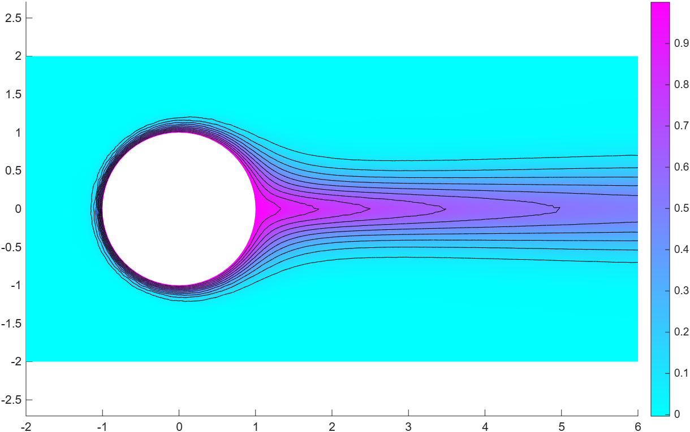
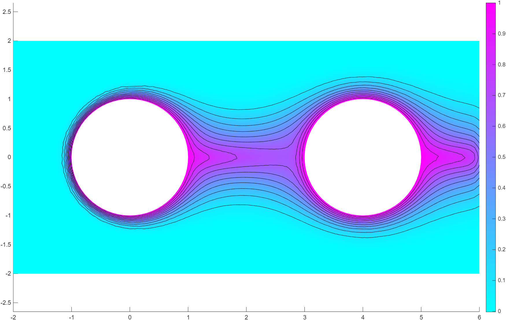

# Numerical Solution of Convection-Dominated Transport Problems (GLS-FEM)

This project was initially made to accompany a mini-lecture.

This repository contains the theoretical analysis and MATLAB finite element implementation for solving stationary convection-diffusion partial differential equations using the **Galerkin Least Squares (GLS)** method, based on Larson & Bengzon (Sections 10.1.6–10.1.8).

## Mathematical Overview
Standard Galerkin finite element methods suffer from severe non-physical oscillations when diffusion is much smaller than the mesh size ($\epsilon \ll h$). To stabilize the solution without losing accuracy, streamline diffusion is added along the flow field $b$:

$$-\epsilon \Delta u + b \cdot \nabla u = f$$

Key theoretical results covered in the accompanying handout (`docs/`):
* **Existence & Uniqueness:** Proven via the Lax-Milgram theorem using a custom GLS energy norm.
* **A Priori Error Estimate:** Derived an error bound of order $\mathcal{O}(h^{3/2})$ in the high-convection regime ($\epsilon \le Ch$).

## Numerical Results
Using MATLAB's PDE toolbox (`initmesh`, `decsg`, and `pdeplot`), heat transfer was simulated in a fluid channel past heated circular obstacles ($\epsilon = 0.01$, $h = 0.1$).

* **Single Cylinder:** Streamline diffusion resolves sharp boundary layers cleanly and prevents downstream oscillations.
* **Multiple Obstacles (`RectCircg2.m`):** Extended the geometry decomposition to model interacting thermal wakes across multiple cylinders.

## Repository Structure
* `src/` — MATLAB geometry (`RectCircg2.m`) and solver scripts.
* `docs/` — Full lecture handout with step-by-step proofs and error analysis.
* `images/` — Contour plots and velocity field glyphs.
